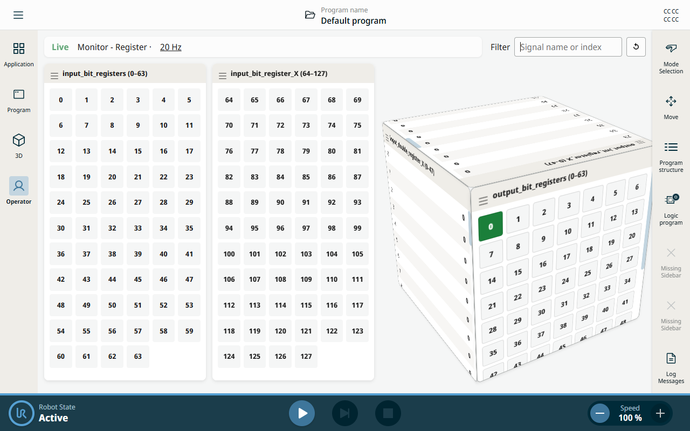

[Debugging Tool] RTDE Monitor
=============================

.. note::
   **Tested on:** PolyScope X 10.15 · **SDK:** 0.22.142 · **Last update:** 2026-Nov-17

.. raw:: html

   
RTDE Monitor is a PolyScope X URCap that shows RTDE general-purpose registers
   and the remaining controller outputs on one Operator Screen. Field names follow the
   <a href="https://docs.universal-robots.com/tutorials/communication-protocol-tutorials/rtde-guide.html" target="_blank">RTDE Guide</a>.

.. admonition:: Download
   :class: note

   .. raw:: html

      
To install the URCapX on a robot, download the version you need from
      <a href="https://github.com/FuNingHu/RTDE-Monitor-X/releases" target="_blank">Releases</a>.

Version compatibility
---------------------

Not every PolyScope X version works with every URCapX version.

.. raw:: html

   <table class="compat-table">
     <thead>
       <tr>
         <th>URCap Version</th>
         <th>1.0.2</th>
         <th>1.0.4</th>
       </tr>
     </thead>
     <tbody>
       <tr>
         <th>PolyScope 10.12</th>
         <td class="compat-no">X</td>
         <td class="compat-no">X</td>
       </tr>
       <tr>
         <th>PolyScope 10.13</th>
         <td class="compat-no">X</td>
         <td class="compat-no">X</td>
       </tr>
       <tr>
         <th>PolyScope 10.14</th>
         <td class="compat-no">X</td>
         <td class="compat-partial">✓*</td>
       </tr>
       <tr>
         <th>PolyScope 10.15</th>
         <td class="compat-yes">✓</td>
         <td class="compat-yes">✓</td>
       </tr>
     </tbody>
   </table>

   
* Functionality is incomplete on PolyScope 10.14.

Choose the page
---------------

Application > Operator Screen lists one entry, Robot Monitor. The configuration
page has a segment selector. Register is selected by default. Robot Status shows
the other controller outputs. The Operator Screen follows that choice.

.. image:: images/rtde_monitor_2.png
   :alt: Robot Monitor selected in Application, with Register highlighted in the segment selector
   :width: 60%

Register
--------

The Register page lists the general-purpose RTDE registers. The first two cards
fill the left side. The other cards sit on a cube, one card on each face. Bit
registers are a grid of cells, and a cell turns green when the bit is 1. Output
bits, integers, and doubles can be changed from this page. The filter matches a
name or an index, and the Hz label sets the sample rate for this page.

Robot Status
------------

Robot Status shows the controller outputs that are not general-purpose
registers, including joints, TCP, I/O, safety, tool, payload, and controller
fields. A value whose name ends in ``_bits`` stays hexadecimal until that row
is clicked, which opens a small cell for each bit. Click the row again to hide
the cells.

.. image:: images/rtde_monitor_elaborated.gif
   :alt: Robot Status page opening the safety_status_bits cells on the cube
   :width: 60%

Turn the cube
-------------

Drag a side face, or the space around the cube, to rotate it. Click a side face
to bring that card to the front. The values stay as they were while the cube is
moving, and sampling resumes one second after it stops. Each page keeps its own
cube angle.

.. image:: images/rtde_monitor_select_focus.gif
   :alt: Robot Status cube turning from Payload and energy through the other status cards
   :width: 60%

Rearrange the cards
-------------------

Move the cards that are your focus. While debugging you usually watch only a
few signals. Drag those cards to the place you are looking, and leave the rest
out of the way.

Hold a card header and drag it. Dropping it on another card swaps the two
positions. Dropping it on an empty position moves the card there. Each page
keeps its own card order and scroll position.

.. image:: images/rtde_monitor_3.png
   :alt: Register page while the output bit card is dragged off the cube
   :width: 60%
