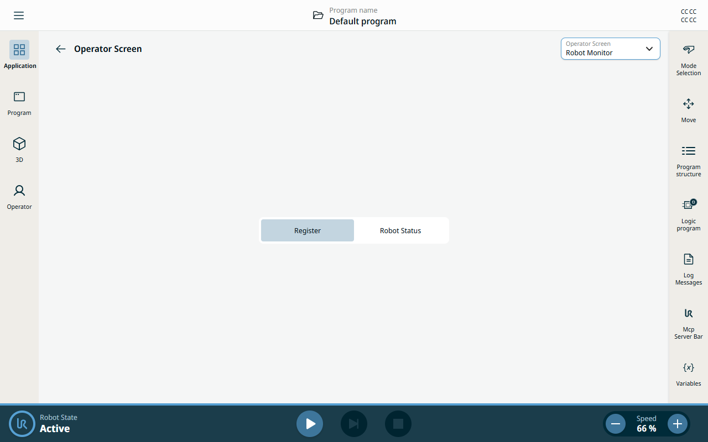
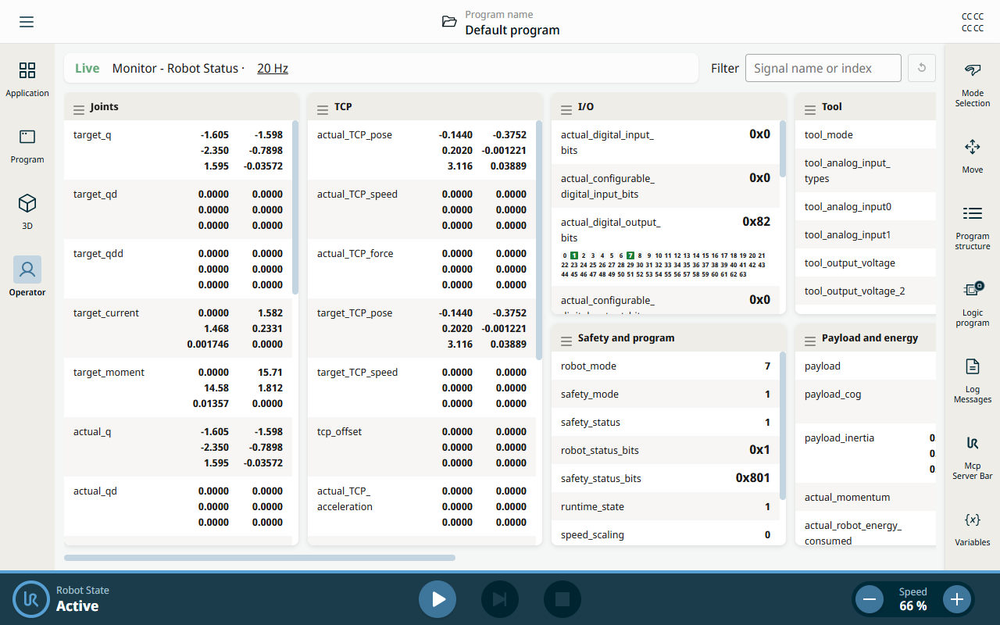
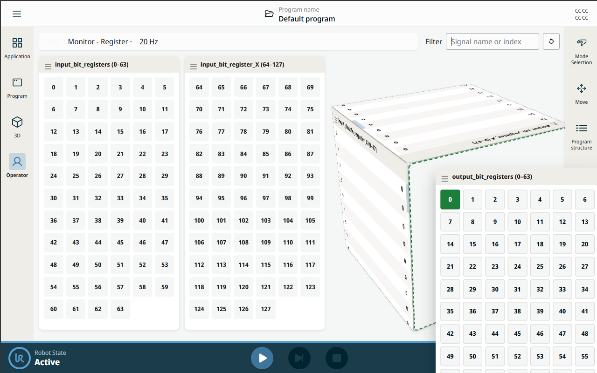

[Debugging Tool] RTDE Monitor
=============================

.. note::
   **Tested on:** PolyScope X 10.15 · **SDK:** 0.22.142 · **Last update:** 2026-Nov-13

.. raw:: html

   
RTDE Monitor is a PolyScope X URCap that shows RTDE general-purpose registers
   and the remaining controller outputs on one Operator Screen. Field names follow the
   <a href="https://docs.universal-robots.com/tutorials/communication-protocol-tutorials/rtde-guide.html" target="_blank">RTDE Guide</a>.

.. admonition:: Download
   :class: note

   .. raw:: html

      
To install the URCapX on a robot, download from
      <a href="https://github.com/FuNingHu/RTDE-Monitor-X/releases" target="_blank">Releases</a>.

Choose the page
---------------

Application > Operator Screen lists one entry, Robot Monitor. The configuration
page has a segment selector. Register is selected by default. Robot Status shows
the other controller outputs. The Operator Screen follows that choice.

Register
--------

The Register page lists the general-purpose RTDE registers. Bit registers are a
grid of cells, and a cell turns green when the bit is 1. Output bits, integers,
and doubles can be changed from this page. The filter matches a name or an
index, and the Hz label sets the sample rate for this page.

.. image:: images/rtde_monitor_1.png
   :alt: Register page with input and output bit grids, integer registers, and double registers
   :width: 60%

Robot Status
------------

Robot Status shows the controller outputs that are not general-purpose
registers, including joints, TCP, I/O, safety, tool, payload, and controller
fields. A value whose name ends in ``_bits`` stays hexadecimal until it is
clicked, which opens a small cell for each bit.

Rearrange the cards
-------------------

Move the cards that are your focus. While debugging you usually watch only a
few signals. Drag those cards to the place you are looking, and leave the rest
out of the way.

Hold a card header and drag it. Dropping it on another card swaps the two
positions. Dropping it on an empty position moves the card there. Each page
keeps its own order and scroll position.

